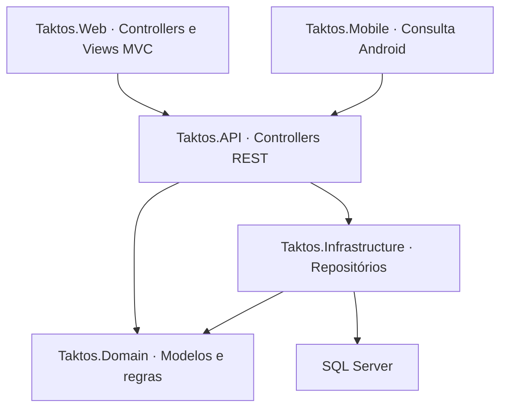
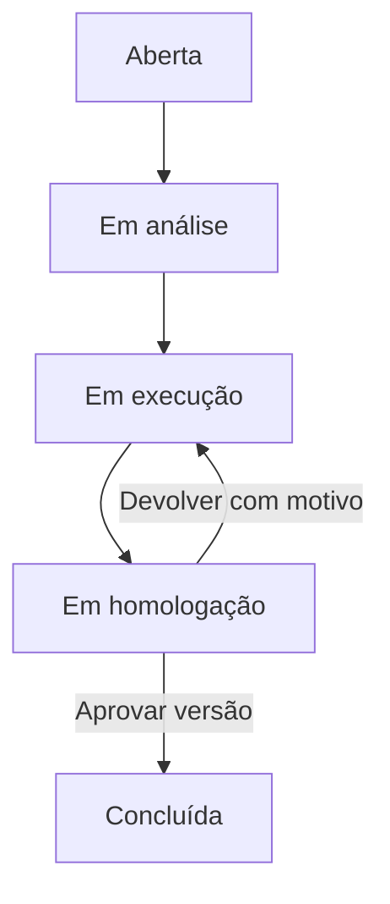

# Arquitetura da solução

O host Taktos.API carrega o projeto Razor MVC e disponibiliza as páginas e os recursos estáticos na mesma origem. A comunicação de dados das telas passa pelas rotas REST. A identidade é criada a partir do login e inclui o perfil e a empresa, usados para restringir as consultas e as alterações. A API verifica o estado e a versão da sessão no banco a cada requisição autenticada. A desativação da conta ou da empresa revoga as sessões, que continuam revogadas mesmo após a reativação.

## Fluxo da OS

A previsão é um campo separado da situação. A fornecedora gerencia triagem, execução e entrega. A TI do cliente homologará as entregas da própria empresa. A GMUD é registrada por referência e, quando disponível, por link HTTPS.

## Modelo lógico

- **Empresas** armazena fornecedoras e clientes. O portal vincula os clientes novos à empresa fornecedora da sessão por `FornecedoraId`. O código gerado permite identificar a empresa na solicitação de cadastro. Uma empresa desativada conserva seus vínculos e OSs e bloqueia o acesso dos seus usuários.
- **Usuarios** vincula as credenciais à empresa. O perfil é derivado do tipo de empresa no login. A senha é gravada como hash. O estado individual da conta é mantido separadamente do estado da empresa.
- **AdministradorId** vincula a administração da equipe a um usuário da própria fornecedora. A API verifica esse vínculo na sessão e as procedures o conferem antes das alterações. **NomePerfil** é o rótulo exibido para a equipe e o papel de acesso continua derivado de **Tipo**.
- **SolicitacoesCadastro** vincula os pedidos de acesso a um cliente cadastrado. A fornecedora vinculada decide sobre cada pedido. A aprovação cria o usuário e registra o responsável e a data da decisão na mesma transação.
- **Sistemas** vincula o sistema à empresa. O relacionamento composto de **OrdensServico** exige um sistema cadastrado para o mesmo cliente da OS.
- **MensagensOrdem**, **Entregas** e **HistoricoOrdem** referenciam a OS. Cada entrega preserva sua versão, a GMUD e o resultado da homologação.
- **IndicadoresOrdem** guarda os cartões personalizados por fornecedora. Cada cartão tem um título e um critério. **IndicadoresPadraoOrdem** guarda as edições dos três cartões padrão por fornecedora. A página calcula as contagens usando as ordens filtradas que o usuário tem permissão para consultar.
- **RelatosInclusao** registra barreiras de acessibilidade, discriminação ou desrespeito. Cada relato pertence ao seu autor e à fornecedora responsável. A leitura fica restrita ao autor e ao Consultor ADM dessa fornecedora. O identificador de uma OS é opcional e o banco verifica se a conta pode consultar a ordem antes de vincular.
- As procedures concentram as transições da OS e usam transações nas alterações. A trigger registra alterações de situação, prioridade, responsável e previsão. Índices apoiam as consultas por empresa, situação e histórico. Um índice filtrado permite uma entrega pendente por OS.

## Rotas

| Método e rota | Papel |
|---|---|
| POST /api/acesso/login e POST /api/acesso/logout | Iniciar e encerrar sessão |
| GET /api/acesso/ | Conta autenticada e clientes acessíveis |
| GET e PUT /api/acesso/perfil | Consultar e editar o próprio perfil |
| GET /api/acesso/usuarios | TI do cliente, com consulta de colegas da mesma empresa |
| GET e POST /api/empresas | Fornecedora, para listar e cadastrar seus clientes |
| PUT /api/empresas/{id} e PUT /api/empresas/{id}/situacao | Fornecedora, para editar o nome e alterar a situação de um cliente |
| POST /api/empresas/{id}/sistemas | Fornecedora, para cadastrar um sistema de cliente da sua carteira |
| POST /api/cadastro | Enviar solicitação de cadastro de cliente |
| GET /api/cadastro/solicitacoes | Fornecedora, com solicitações de seus clientes |
| POST /api/cadastro/solicitacoes/{id}/decisao | Fornecedora, para aprovação ou recusa |
| GET e POST /api/cadastro/contas | Fornecedora, para listar contas da sua carteira ou cadastrar uma conta cliente ativa |
| PUT /api/cadastro/contas/{id} e PUT /api/cadastro/contas/{id}/situacao | Fornecedora, para editar dados, redefinir a senha e alterar a situação individual |
| GET e POST /api/equipe/usuarios | Administrador da fornecedora, para listar e cadastrar usuários internos |
| PUT /api/equipe/usuarios/{id} e PUT /api/equipe/usuarios/{id}/situacao | Administrador da fornecedora, para editar dados e alterar a situação dos demais usuários internos |
| PUT /api/equipe/identidade | Administrador da fornecedora, para atualizar o nome da sua empresa e o rótulo do perfil |
| GET /api/indicadores | Fornecedora e seus clientes, para consultar as definições dos cartões |
| POST /api/indicadores | Fornecedora, para cadastrar um cartão da sua empresa |
| PUT /api/indicadores/{id} | Fornecedora, para editar o título e o critério de um cartão padrão ou personalizado |
| GET /api/relatos | Autor e Consultor ADM responsável, com consulta por vínculo |
| POST /api/relatos | Usuário autenticado, para cadastrar um relato |
| PUT /api/relatos/{id}/situacao | Consultor ADM responsável pelo relato, para iniciar a análise ou responder |
| GET /api/ordens e GET /api/ordens/{id} | Consulta conforme empresa e perfil |
| GET /api/ordens/opcoes | Sistemas do cliente ou responsáveis da fornecedora |
| POST /api/ordens | TI do cliente |
| PUT /api/ordens/{id}/triagem | Fornecedora |
| POST /api/ordens/{id}/mensagens | Perfis com acesso à OS |
| POST /api/ordens/{id}/entregas | Fornecedora |
| POST /api/ordens/{id}/entregas/{entregaId}/homologacao | TI do cliente |

A aplicação móvel mantém a sessão em memória e usa as rotas de consulta para atualizar a lista e os detalhes. O portal web inclui um guia de uso público e controles acessíveis por teclado.
